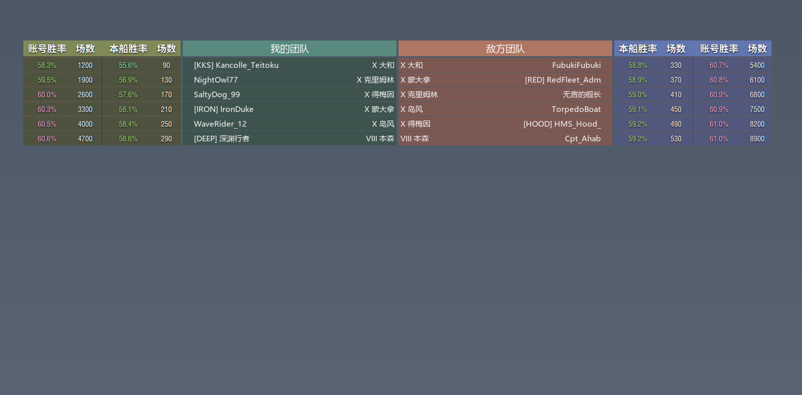

# wowsyukari-nano

**English** | [简体中文](README.zh-CN.md)

Shows both teams' win rates beside the team list while **Tab** is held in *World of Warships*.



## Features

- While Tab is held, four more columns appear on each outer side of the team list: the ship's win rate and battles next to the list, the account's outside it. Headings, row colours, row spacing and lettering are taken from the game's own list, so they read as part of it.
- Both teams' accounts and ships come from the battle replay the game is writing (read only); the numbers come from the public profile data (random battles) and are fetched in the background when a battle starts.
- A mouse click while Tab is held (picking a player, opening the context menu) hides the columns; they come back the next time Tab is pressed.
- The columns can be captured in screenshots and streams (`overlay.capturable`); with that off, the window takes part in no screen capture at all.

## Usage

**Packaged build**: download `wowsyukarinano_v1.0.zip` from
[Releases](https://github.com/hUUU327/wows_seamonkey_radar/releases), unpack it and run
`wowsyukarinano.exe`. (If no release is published yet, build it from source.)

**From source**: Python 3.12, Windows 10/11

```
python -m venv .venv
.venv\Scripts\python -m pip install -r requirements.txt
wowsyukarinano.bat
```

### Game settings

- The client must run in **windowed fullscreen** — exclusive fullscreen hides every overlay.
- **Replay recording must be on** (Settings → Other → Replays): the player list is read from the battle replay.

## Configuration

`config.json` sits next to the program; restart after editing it.

| Key | Meaning |
| --- | --- |
| `game_dir` | game install folder; empty: found automatically (running game, registry, Steam libraries, common folders) |
| `trigger.window_title` / `trigger.game_exe` | how the game window is recognised in the foreground |
| `live_replay.folder` | replays folder; empty: `<game folder>\replays` |
| `overlay.capturable` | whether the columns appear in screenshots and streams, default `true` |

## Build

```
build.bat
```

The result is `local\dist\wowsyukarinano\wowsyukarinano.exe` (PyInstaller, one folder, no console).

## Layout

| Path | Contents |
| --- | --- |
| `wowsyukarinano\app.py` | entry point, worker thread, main loop |
| `wowsyukarinano\livereplay.py`, `replaydata.py` | follow the battle replay, decode the player list |
| `wowsyukarinano\roster.py` | find the team list on screen and match each row |
| `wowsyukarinano\playerstats.py` | fetch the public win rates |
| `wowsyukarinano\overlay.py` | the transparent overlay that draws the columns |
| `wowsyukarinano\mainwindow.py`, `vista.py` | main window and window look |
| `wowsyukarinano\capture.py`, `screen.py`, `monitor.py` | screen capture, resolution mapping, monitor switching |
| `wowsyukarinano\gamedir.py`, `gamefiles.py`, `shipdata.py`, `ships.py` | find the game, read client files, ship names |
| `local\assets` | pictures, icon, fonts, ship list |

## Limitations

- Windows only, and it needs a network connection.
- **Random battles** only (the public profiles publish those); other modes show `—`, and a hidden profile shows `战绩已隐藏` ("profile hidden").
- It reads the replay file and public web pages only: it does not modify the game, read its memory or inject anything.
- After a game update the ship list is rebuilt automatically; if the replay format changes, the program says so and the win rates stay off.
- Third-party overlays may break the game's terms of service; use at your own risk.

## License

The code is released under [the Unlicense](LICENSE): public domain, no rights reserved. Use, modify,
distribute and sell it for any purpose, with no attribution and no warranty.

`local/assets/fonts` and `local/assets/ships.json` come from the game client and remain the property of
Wargaming; they are included only so the interface matches the game.
